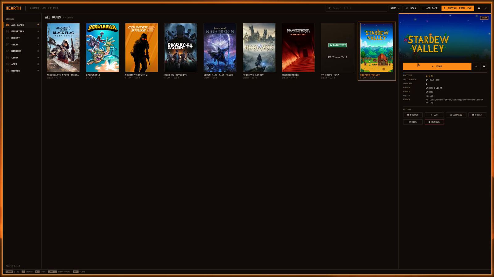

# hearth

[](https://github.com/Tjabooo/hearth/actions/workflows/ci.yml) [](https://github.com/Tjabooo/hearth/releases) [](LICENSE)

A game launcher for Linux that puts Steam, Lutris, repacks and portable games in one library, with
per-game Proton/Wine, MangoHud, gamemode and gamescope settings, and a one-click "install from .exe".



## Features

- **Finds your games on its own**
  - Steam libraries (every library folder, play time and last-played from Steam, cached cover art)
  - Lutris (games, play time, runner, prefix, environment, gamescope and pre-launch settings)
  - Game folders such as `~/Games`: repacks (FitGirl, DODI, …), portable Windows games, native
    games and AppImages. The main `.exe` is picked by name, size and depth; uninstallers,
    redistributables and crash handlers are skipped.
  - Games installed inside Wine prefixes (`C:\Games`, Program Files, the user folder)
  - `.desktop` entries in the Game category (Flatpaks, emulators)
- **Install from .exe**: pick a `setup.exe`, hearth makes a fresh prefix, points the installer at
  your games folder (`X:\Games\<name>` for Inno Setup and NSIS installers) and adds the game when the
  installer is done. It keeps running if you close the window.
- **Per-game settings like Lutris**, each one either set or inherited from your defaults:
  Proton build (GE-Proton, Steam Proton, any build with a `proton` script) or Wine build, prefix,
  arguments, working folder, ntsync/fsync/esync, FSR 4 upgrade, Wine Wayland driver, WineD3D,
  DXVK HUD, MangoHud (plus extra MangoHud config), gamemode, gamescope (resolution, refresh, upscaler,
  cursor grab, HDR, extra flags), CPU set, nice level, launch wrapper, pre-launch and post-exit
  scripts, stop-prefix-on-exit, environment variables.
- **Prefix tools**: run any `.exe` in a game's prefix (patches, trainers), winecfg, regedit, winetricks.
- **Play time** counted per game, including launchers that fork and exit (every process started for
  the game is tracked), merged with what Steam and Lutris already counted.
- **Cover art** from Steam's library art; for non-Steam games hearth looks the title up on the Steam
  store, then Lutris.net (only the title is sent; can be turned off). Games with no cover anywhere
  show the icon pulled out of their own `.exe`.
- **CLI** for scripts and app launchers: `hearth launch <id>`, `hearth list`, `hearth scan`.

## Install

Needs GTK 4.16+, Rust, and for Windows games a Proton build (e.g. GE-Proton) plus ideally
[umu-launcher](https://github.com/Open-Wine-Components/umu-launcher). Optional: gamescope,
gamemode, MangoHud, winetricks, curl (cover art).

```sh
# Arch
sudo pacman -S --needed gtk4 rust curl
yay -S umu-launcher      # optional but recommended

git clone https://github.com/Tjabooo/hearth
cd hearth
./install.sh             # ~/.local/bin/hearth + desktop entry + icon
```

## Usage

Open **Hearth** from your app launcher, or run `hearth`.

| | |
|---|---|
| `Enter` | play the selected game |
| type or `/` | search |
| `F5` | scan for new games |
| `Ctrl+,` | preferences |

```sh
hearth scan --art            # find new games, fetch missing covers
hearth list                  # id, runner, play time, name
hearth launch <id>           # start a game (returns right away)
hearth launch <id> --dry-run # print the exact command and environment
hearth stop <id>
hearth install ~/Downloads/Some\ Game\ \[FitGirl\ Repack\]/setup.exe
hearth runners               # Proton/Wine builds and tools found
```

## Configuration

`~/.config/hearth/config.toml` (created on first run, also editable in Preferences):

```toml
game_dirs = ["~/Games"]                 # every sub-folder is a game
prefix_dirs = ["~/Games/Prefixes"]      # one prefix per sub-folder; games inside are found
install_root = "~/Games"                # where "Install from .exe" installs to
prefix_root = "~/Games/Prefixes"        # where new prefixes go
steam_command = ["steam", "steam://rungameid/{appid}"]
wrapper = []                            # e.g. ["mullvad-exclude"]; per game: "Use launch wrapper"

[mangohud_env]                          # what "MangoHud on" sets
MANGOHUD = "1"

[defaults]                              # every game inherits these unless it overrides them
proton = "latest"                       # newest GE-Proton
mangohud = false
gamemode = true
```

Games live in `~/.config/hearth/games/<id>.toml`, play time in `~/.local/share/hearth/stats/`,
cover art in `~/.local/share/hearth/art/<id>/`, launch logs in `~/.local/state/hearth/logs/`.

## How it works

- The window never runs a game itself: Play starts `hearth run <id>` in its own session. That
  supervisor runs the pre-launch script, starts the game with `HEARTH_GAME=<id>` in its environment,
  and keeps counting until no process with that tag is left (Wine's own background processes don't
  count), then runs the post-exit script. Steam games are handed to Steam and followed through
  Steam's `reaper` process.
- Windows games run through `umu-run` with `PROTONPATH` set to the chosen build (plain
  `proton waitforexitandrun` if umu isn't installed). Wrappers are applied innermost first:
  gamescope, gamemoderun, taskset, then your launch wrapper.
- Installs run as `hearth install …` jobs. Wine assigns some drive letters to mount points by itself
  (often `X:` → home), so hearth uses whichever drive already reaches the games folder or maps a
  free one, passes `/DIR=` (Inno Setup) or `/D=` (NSIS) so the installer suggests the right folder,
  waits for the installer and everything it spawned, then picks the new folder's main `.exe`.

## License

MIT
